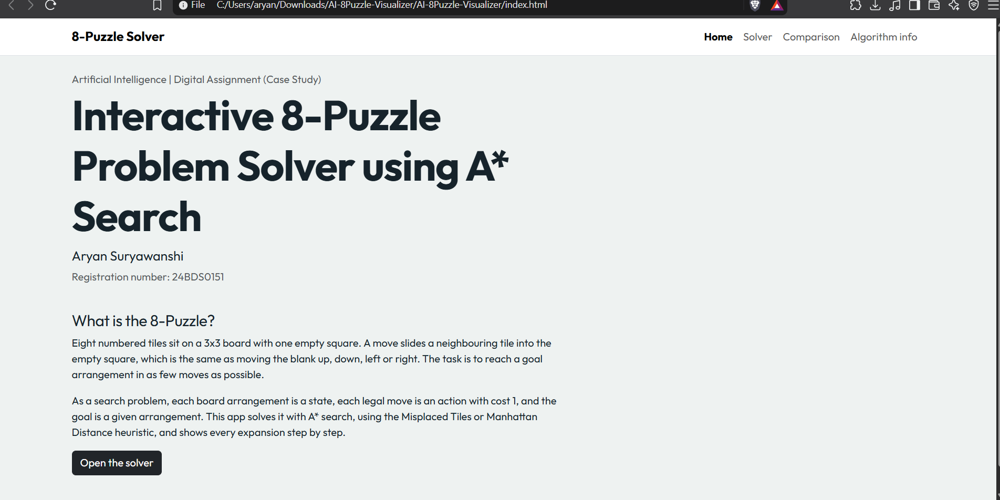
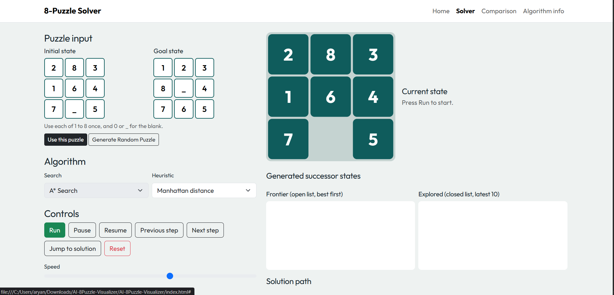
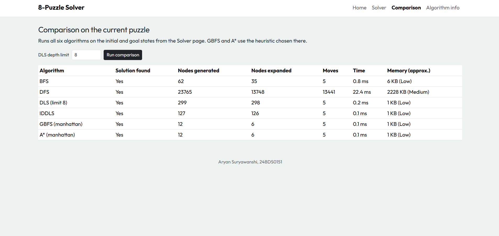
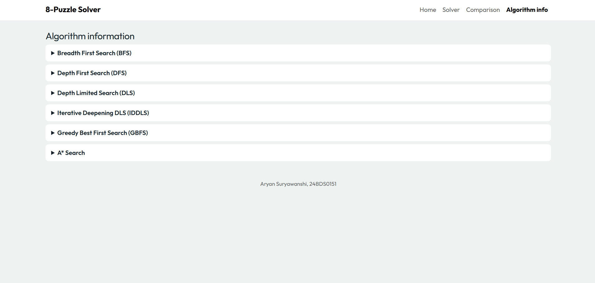

# AI-8Puzzle-Visualizer

## Project description
An interactive web app that solves the 8-Puzzle with **A\* Search** and visualises every step: the node being expanded, generated successors, frontier and explored lists, g(n), h(n), f(n), and the animated blank-tile solution path. A comparison page also runs BFS, DFS, DLS, IDDLS, GBFS and A\* on the same puzzle.

## Technologies used
HTML5, CSS3, JavaScript (ES6), Bootstrap 5.3 (CDN), CSS transitions for the tile animation.

## Search algorithms implemented
Assigned algorithm: **A\* Search** (algorithm 7), with full step-by-step visualisation. BFS, DFS, DLS, IDDLS and GBFS are included in `js/puzzle.js` only to fill the comparison table.

## Heuristics used
- Misplaced Tiles
- Manhattan Distance

## Features
Manual input and random solvable puzzle, solvability check (inversion parity), Run / Pause / Resume / Next / Previous / Reset / Speed, live search statistics, solution summary, comparison table, algorithm information page.

## Screenshots

### Home Page

### Solver

### Comparison

### Algorithm Information

## GitHub Pages URL
https://crycnspams.github.io/AI-8Puzzle-Visualizer

## Student details
Aryan Suryawanshi, 24BDS0151, Artificial Intelligence (Digital Assignment, Algorithm 7)

## References
- Russell and Norvig, *Artificial Intelligence: A Modern Approach*
- Bootstrap 5 documentation
- Code written with the help of an AI assistant (Claude by Anthropic) and reviewed by the student.

## How to run
Open `index.html` in a browser (no build step). To host: push to GitHub, then Settings > Pages > Deploy from branch `main`, folder `/ (root)`.
